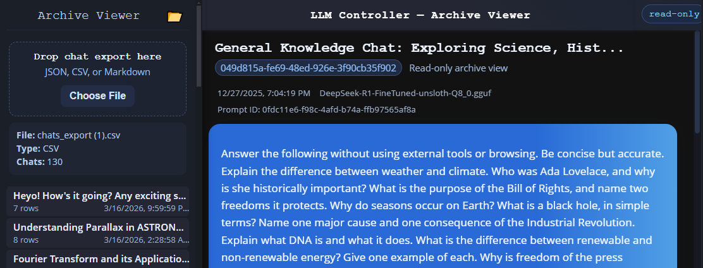

# LLM Controller Archive Viewer

Standalone read-only viewer for LLM Controller chat exports.

Supports:
- CE v1.5 JSON conversation backups and older flat JSON exports
- CSV conversation exports
- CE escaped-table Markdown exports and older supported Markdown layouts

Drag in an export file and browse archived chats in a simple LLM Controller-style interface.

## Purpose

LLM Controller Archive Viewer is a lightweight standalone tool for opening exported chat archives without needing the main LLM Controller app or API.

## Status

Early standalone release.

## Opening an archive

Open `archive-viewer.html` in a modern browser. Keep `archive-viewer.js`,
`archive-viewer.css`, `style.css`, and `marked.min.js` beside it. Choose a file
or drop it on the sidebar. No installation, server, API, or database is needed.

Conversations retain the existing sidebar and message layout. Edited prompts
and regenerated responses appear together under their original turn. Use
**View version** to inspect alternatives; the exported active version is selected
initially. Browsing a different version does not rewrite the archive or change
later turns. Active/inactive labels always describe the exported state.

Reasoning is collapsible, including when no final answer was recorded. Message
metadata includes model, timestamp, version identifiers, source row, generation
speed, prompt evaluation speed, token count, and response time when present.
Admin exports keep conversations separate by both user and session ID. JSON
project membership appears in the conversation heading.

## CE export contract

Compatibility follows the supplied CE source (`analytics_routes.py`,
`chat_routes.py`, and `attachment_utils.py`), without running CE or opening its
database.

| Format | Exported information |
| --- | --- |
| Current JSON | Object with `format: "llm-controller-ce-chat-backup"`, numeric `version: 1`, and `chats`, `projects`, `chat_sessions` arrays |
| Older JSON | Flat array of chat rows, including supported older field aliases |
| CSV | All exported chat columns; no separate project definitions or membership table |
| CE Markdown | All chat columns in a table, identified by `<!-- llm-controller-markdown-export: escaped-table-v1 -->`; escaped backslashes, pipes, and newlines are decoded |
| Older Markdown | Recognized chat tables or heading-based User/Assistant/Thoughts/Attachment Context sections; only information actually present is available |

Each CE chat row pairs `user_message` and `bot_response`, with optional `thoughts`
and statistics. `turn_id` groups revisions; editing increments `prompt_version`,
regeneration increments `response_version`, and `source_row_id` identifies the
revision's source row. `prompt_id` identifies a particular generation.
`active_in_chat` identifies the saved selection. Revisions stay within their
turn instead of being appended as new conversational exchanges. Turns follow
the earliest exported row in chronological order, using row IDs to break ties.
Rows without a turn ID remain separate; missing relationships are not inferred.

There is no separate conversation branch tree in the inspected export contract.
The Viewer preserves the available turn/version/source-row relationships; it
cannot reconstruct an unexported branch or downstream history for an alternate
response. If selection metadata is missing, the first version is shown without
claiming it was active. Empty conversations and recognized empty archives are
supported. Unknown JSON backup versions and unrecognized records produce errors.

## Embedded images and attachments

CE stores `attachment_context` as a JSON string containing
`type: "llm-controller-attachments"`, version `1` or `2`, and an ordered
`attachments` array. Image records contain `kind: "image"`, `name`, `mime_type`,
`size`, and `data_url: "data:image/...;base64,..."`. These are image bytes inside
data URLs, not server file paths. CSV and CE Markdown preserve this same field,
so they can also display embedded images.

Images appear after the associated user text in attachment order, matching CE's
presentation. Embedded raster image data URLs in Markdown message content also
display in place, including assistant content. The inspected CE exporter does
not emit a separate assistant attachment collection or multimodal message array.
Remote image references are shown as unavailable offline and are not fetched.

The Viewer checks Base64 syntax, raster MIME types, and file signatures, then
uses browser image decoding with lazy loading. Images fit their message while
preserving aspect ratio; click or keyboard-activate an image to enlarge it and
use Close or Escape to dismiss it. Attachment parsing and image validation are
cached for the loaded archive. No object URLs or image conversion dependencies
are used. Raw HTML remains escaped, and SVG/active image content is not enabled.
Malformed data or browser decode failures display a readable attachment notice.

PNG, JPEG, GIF, WebP, BMP, and AVIF rendering depends on browser codec support.
**TIFF and HEIC/HEIF previews remain browser-dependent:** CE normally converts
these through its server-side preview endpoint, but exports do not include that
converted PNG. The offline Viewer attempts native decoding and displays a notice
when unavailable; it does not provide an equivalent conversion service.

Text and converted-document content is available in collapsible attachment
sections. Original document binaries are not exported by CE. Older unstructured
attachment contexts retain an indicator; missing image bytes cannot be recovered.

## Validation and release checks

The implementation was reviewed against the CE export, revision, attachment,
and chat rendering source. `node --check archive-viewer.js` passes. This project
has no configured build or existing automated test suite; none was added.

No real export samples were found in the supplied project folders. Browser tools
reported no available browser, so archive loading and visual interactions have
**not** been verified in a browser. Source compatibility and syntax checks are
not a claim of completed end-to-end validation.

Before release, manually verify in the browsers you support:

1. Open an actual v1.5 JSON backup containing edits, regenerations, inactive
   responses, reasoning, projects, nullable fields, and empty conversations.
   Compare titles, turn order, version pairs, active selections, source rows,
   model names, timestamps, and statistics against CE.
2. Open older flat JSON, CSV, current escaped-table Markdown, and an older
   supported Markdown export. Check multiline text, commas, quotes, pipes,
   backslashes, and attachment data. Confirm admin exports do not combine users
   that share a session ID.
3. Check multiple embedded images, attachment-only prompts, and an assistant
   Markdown data-URL image. Verify aspect ratios, enlargement, Escape/Close,
   keyboard focus, switching versions, switching chats, and reopening a file.
4. Check missing image bytes, invalid Base64, mismatched MIME types, corrupt
   images, unsupported attachment versions, and TIFF/HEIC fallback notices.
   Confirm SVG/HTML and remote image references do not execute or fetch content.
5. Open an empty backup, empty flat JSON array, header-only CSV/CE Markdown,
   malformed JSON/CSV, unsupported backup versions, and unrelated files.
   Confirm useful errors and successful recovery by loading a valid archive.
6. Check file selection and drag-and-drop, desktop and narrow-screen layout,
   a large image-heavy archive, and operation with the network disconnected.

No migration, configuration, database, or CE-side operator changes are required.

## GUI

## Related Projects

- [LLM Controller CE](https://github.com/tensioncore/llm-controller-ce)

## Attribution

Developed by **Tensioncore Administration Services**.
